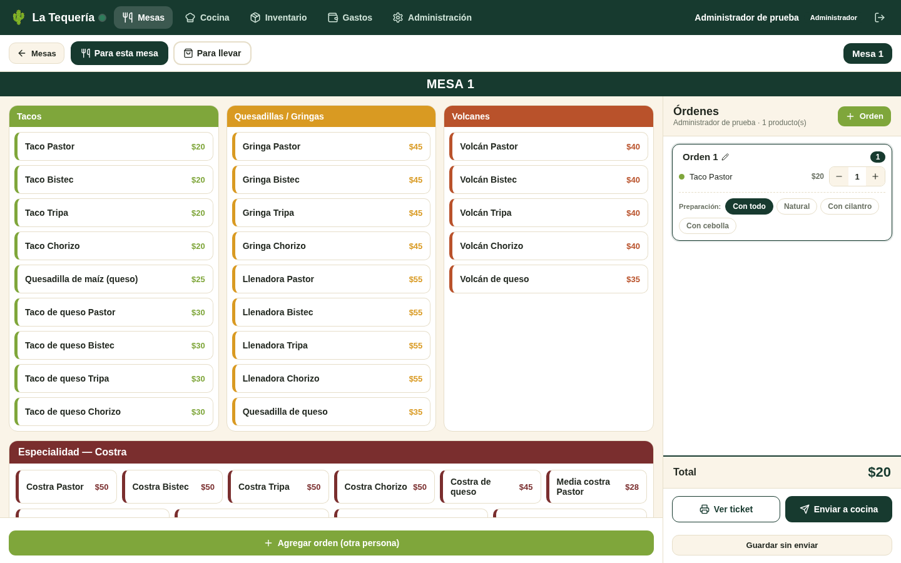
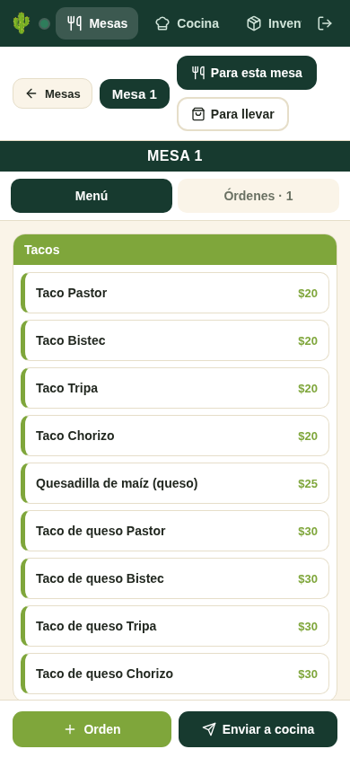

# Auditoría de diseño y usabilidad — La Tequería

**Fecha:** 30 de octubre de 2026. **Versión:** [`f38742d65daddf4bc8a4c5ce386019420bc37df7`](https://github.com/EdRes155/La-Tequeria/commit/f38742d65daddf4bc8a4c5ce386019420bc37df7). Las referencias de código son relativas a `tequeria-app/` en ese commit.

Tercer enfoque solicitado: experiencia móvil y de escritorio, navegación, accesibilidad y facilidad para gestionar comandas. Complementa las auditorías [integral](AUDITORIA-LA-TEQUERIA.md) y de [seguridad y datos](AUDITORIA-SEGURIDAD-Y-DATOS.md). Esta entrega documenta hallazgos y añade evidencia reproducible; no rediseña la aplicación ni cambia su código de producto.

## Diagnóstico y método

**La interfaz tiene una identidad visual coherente y una estructura adecuada para una taquería, pero todavía permite perder trabajo y confunde estados importantes del pedido.** Antes de pulir detalles estéticos conviene resolver los borradores, la confirmación de envío y la selección de persona. Hay además barreras verificadas de contraste, foco y controles accesibles.

Se documentan **12 hallazgos: seis P1 y seis P2**. P1 significa resolver antes de confiar en el flujo durante el servicio; P2, corregir en la siguiente iteración de usabilidad. Son prioridades de producto, no una clasificación de vulnerabilidades ni una certificación WCAG.

**Evidencia nueva:** recorrido de navegador Chromium sobre el cliente real en local, conservando `App.jsx`, `store.js` y sus estilos. Solo se sustituyó el módulo de conexión por un adaptador sintético en memoria, con tres operadores de prueba, ocho mesas, el catálogo estándar de comida y dos bebidas. Esto permitió simular guardados y fallos sin una cuenta Supabase ni datos reales. Se bloquearon peticiones fuera del servidor local.

Se recorrió el flujo administrador → mesas → comanda → productos/órdenes → envío o borrador, y se inspeccionó domicilio, teclado y estilos computados. Las operaciones del adaptador no equivalen a persistencia ni recepción por cocina en producción. Los nombres de operadores, cantidades y estados de las capturas son ficticios.

| Comprobación | Entorno y resultado |
|---|---|
| Mesas responsive | 320×568, 390×844, 760×1024, 768×1024 y 1440×900; sin desbordamiento horizontal de documento o panel principal en esa pantalla |
| Comanda y cambio de diseño | Móvil 390×844, límite 760×1024 y escritorio 1440×900; a 760 px se muestran dos paneles de 380 px |
| Borrador, error de envío y varias personas | Reproducciones mediante clics reales con datos sintéticos |
| Diálogo de domicilio | Inspección DOM, Tab y Escape; seis campos sin etiquetas vinculadas |
| Contraste y objetivos táctiles | Colores computados, cálculo sRGB y medidas de los botones de cantidad |
| Cobertura automatizada | Ocho escenarios agrupados, ocho capturas y [resultados JSON](auditoria/ux-evidencias/resultados.json); sin excepciones JavaScript no capturadas durante el recorrido |

No hubo pruebas con meseros reales, lector de pantalla, Safari/iPad físico, teclado virtual móvil, impresora térmica o condiciones reales de iluminación y conectividad. No se midieron tiempos de tarea, tasas de error ni satisfacción; no se inventa una puntuación global de usabilidad.

### Vistas revisadas

**Comanda de escritorio — datos ficticios:** la lista de productos y el pedido permanecen en paralelo, lo que facilita comprobar cantidades antes de enviar.



**Comanda móvil — datos ficticios:** las pestañas evitan estrechar ambos paneles, pero el menú no muestra la persona activa.



Otras capturas: [Mesas móvil](auditoria/ux-evidencias/01-mesas-movil.png), [éxito tras fallo simulado](auditoria/ux-evidencias/03-envio-fallido-con-exito.png), [menú con segunda persona activa](auditoria/ux-evidencias/04-menu-sin-persona-activa.png), [domicilio](auditoria/ux-evidencias/05-domicilio-movil.png), [borrador mostrado como mesa ocupada](auditoria/ux-evidencias/07-borrador-como-mesa-ocupada.png) y [comanda a 760 px](auditoria/ux-evidencias/08-comanda-760px.png).

## Hallazgos prioritarios

### UX-01 · P1 · Salir de la comanda pierde el trabajo sin advertencia

**Reproducción:** abrir una mesa libre, añadir un producto, pulsar «Mesas» y volver a abrirla. La pestaña muestra «Órdenes · 0»; no aparece una confirmación ni se conserva el pedido. Verificado en navegador, escenario UX-B02.

**Causa y efecto:** el pedido vive en el estado del componente (`src/App.jsx:755–763`) y los enlaces de salida llaman directamente a `go()` (`:678,896`). Una consulta rápida a otra pantalla puede obligar al mesero a reconstruir la comanda y recordar sus detalles.

**Cambio recomendado:** guardar un borrador por mesa/tipo y mantenerlo al navegar. Si una acción implica descartarlo, ofrecer «Seguir editando», «Guardar borrador» y «Descartar», con una consecuencia explícita. No presentar el borrador como enviado a cocina.

**Aceptación:** cambiar de sección y volver conserva productos, cantidades, preparación y persona activa; descartar requiere una decisión explícita. Comprobar también recarga y cierre accidental si se promete recuperación entre sesiones.

### UX-02 · P1 · «Guardar sin enviar» produce un estado ambiguo y falta en móvil

**Reproducción:** en escritorio, añadir un producto y guardar sin enviar. Al reabrir aparece «Lo que ya se pidió» y la acción «Reenviar a cocina», aunque el adaptador aún tiene cero tickets. Verificado en UX-B06 y en su captura. En móvil esa acción de guardar no se renderiza (`src/App.jsx:1133–1161`).

**Efecto:** el lenguaje mezcla borrador, pedido recibido y reenvío. El usuario no sabe si cocina vio la orden ni cómo terminarla. La diferencia entre móvil y escritorio hace impredecible una tarea frecuente.

**Cambio recomendado:** distinguir «Borrador», «Enviando» y «Recibido en cocina» con texto persistente. Un borrador debe permitir «Continuar editando» y «Enviar a cocina» desde cualquier tamaño; «Reenviar» debe corresponder a un pedido ya enviado. Conservar un indicador de estado en la tarjeta de mesa.

**Aceptación:** el mismo borrador puede guardarse y retomarse desde móvil o escritorio, y enviarse una sola vez con un estado comprensible. Este problema también se describe desde la integridad contable en las auditorías anteriores; aquí se comprobó su presentación al operador.

### UX-03 · P1 · Un envío fallido comunica éxito y abandona la comanda

**Reproducción:** activar fallo de escritura en la fixture, añadir un producto y enviar. La UI vuelve a Mesas y muestra «Comanda enviada a cocina», mientras el adaptador conserva cero tickets. Verificado en UX-B03; la captura muestra además la mesa ocupada y el contador de cocina incrementado de forma optimista.

**Evidencia:** `src/App.jsx:872–874` confirma y navega antes de comprobar persistencia; `src/store.js:149–152` captura el error sin comunicar fallo al consumidor. Es un hallazgo previo de fiabilidad, ahora reproducido desde el navegador.

**Cambio recomendado:** mantener la orden visible con «Enviando…», mostrar éxito solo tras confirmación, y conservar «No se pudo enviar» con reintento seguro. Distinguir conexión a Realtime de confirmación de esa orden concreta. Una señal de conexión coloreada no basta para explicar el resultado.

**Aceptación:** un fallo no muestra éxito ni obliga a reconstruir el pedido; al recuperar conexión se puede reintentar sin duplicarlo. La validación de recepción real requerirá un entorno de prueba con backend.

### UX-04 · P1 · La persona activa queda oculta en el menú móvil y no tiene selección clara por teclado

**Reproducción:** añadir productos a Orden 1, crear Orden 2 y volver a Menú. No aparece «Orden 2» en el contenido de la comanda; los siguientes productos se añaden a ella. Verificado en UX-B04. El bloque de orden es un `DIV` sin rol ni tabulación, medido en UX-B07; su selección depende de `onClick` (`src/App.jsx:1213`). Los botones internos ejecutan otras acciones y detienen la propagación.

**Efecto:** aumenta el riesgo de asignar productos a la persona equivocada, especialmente al alternar pantallas. Un usuario de teclado carece de un control explícito para volver a seleccionar una orden existente.

**Cambio recomendado:** mantener «Añadiendo a: Orden 2 / nombre» junto al menú y ofrecer un selector accesible de persona. Separar seleccionar de renombrar; comunicar el estado seleccionado de forma programática y visible.

**Aceptación:** antes de tocar un producto se reconoce su destinatario en ambos diseños. Todas las órdenes pueden seleccionarse con teclado sin alterar su nombre, sus cantidades o su preparación.

### UX-05 · P1 · Los diálogos permiten que el foco salga y Escape no los cierra

**Reproducción:** abrir Domicilio, enfocar su último botón y pulsar Tab; el foco sale del diálogo. Pulsar Escape lo deja abierto. El contenedor no declara `role="dialog"` ni `aria-modal`. Verificado en UX-B05; los otros diálogos comparten el patrón de `div` (`src/App.jsx:287–361,1258–1286,1389`).

**Efecto:** una persona que navega con teclado puede interactuar con la pantalla tapada, perder su posición y no reconocer el contexto modal. El campo PIN tiene `autoFocus`, pero eso no resuelve la gestión completa del diálogo.

**Cambio recomendado:** usar un diálogo accesible con nombre, foco inicial adecuado, navegación contenida, Escape cuando sea aplicable y restitución del foco al activador. Al descartar información no guardada, combinarlo con la prevención de pérdida de trabajo.

**Aceptación:** Tab y Shift+Tab permanecen dentro; Escape y cerrar tienen efectos previsibles; al salir se recupera el foco y no se activa una acción de la pantalla posterior. Verificar anuncio y lectura con lector de pantalla como prueba pendiente.

### UX-06 · P1 · El catálogo usa contrastes insuficientes en texto pequeño

Se midieron estilos computados y se calculó la relación de luminancia sRGB, escenario UX-B07:

| Elemento | Colores | Tamaño observado | Contraste |
|---|---|---|---|
| Cabecera Tacos | Blanco sobre `#7FA63B` | 14 px, peso 700 | **2,83:1** |
| Cabecera Quesadillas / Gringas | Blanco sobre `#D99A22` | 14 px, peso 700 | **2,44:1** |
| Cabecera Volcanes, referencia de contraste adecuado | Blanco sobre `#B9522B` | 14 px, peso 700 | 4,88:1 |

Los dos primeros pares quedan por debajo del criterio de 4,5:1 de [WCAG 1.4.3 para texto normal](https://www.w3.org/WAI/WCAG22/Understanding/contrast-minimum.html). Los precios usan esos mismos colores sobre blanco a 13 px, y «Agregar orden» usa blanco sobre lima (`src/App.jsx:2118–2123,2186`). La negrita de 14 px no convierte este texto en texto grande a efectos del criterio.

**Cambio recomendado:** conservar la paleta como identidad y acento, pero usar variantes más oscuras para texto/fondos de acciones o una tinta suficientemente contrastada. Evitar asignar información esencial solo al color.

**Aceptación:** cada combinación activa de texto normal alcanza 4,5:1; se revisan además foco, bordes e indicadores conforme a su criterio específico. Esto no representa una certificación completa de la aplicación.

## Mejoras de la siguiente iteración

### UX-07 · P2 · Formularios, iconos y objetivos táctiles necesitan contexto y foco visible

**Evidencia:** los seis campos de domicilio tienen cero etiquetas asociadas en el DOM; cerrar el diálogo no tiene texto ni `aria-label` (UX-B05). Los botones de cantidad miden **30×30 px** y solo contienen SVG, sin nombre contextual (UX-B07). En código, eliminar orden o gasto usa áreas de aproximadamente 23×23 px; el input de precios elimina el outline sin alternativa y los switches no exponen un indicador visual de foco (`src/App.jsx:1224,1263–1279,1734,2170–2173,2256,2312`).

**Cambio recomendado:** asociar labels persistentes, marcar campos obligatorios y nombrar acciones con el producto afectado: «Aumentar Taco Pastor», «Eliminar Orden 2», «Cerrar datos de domicilio». Usar una superficie táctil de diseño de al menos 44×44 px en acciones frecuentes y foco visible en todos los controles. **30×30 no es por sí solo un incumplimiento del mínimo AA de WCAG 2.2**; el tamaño mínimo y las excepciones de espaciado deben comprobarse con su contexto.

**Aceptación:** teclado y lector identifican finalidad/estado; aumentar o eliminar no exige precisión excesiva; cada control enfocado se reconoce visualmente. Los placeholders pueden dar un nombre en algunos entornos, pero no sustituyen la asociación de etiquetas e instrucciones.

### UX-08 · P2 · Borrar una orden con productos no permite recuperarla

**Reproducción:** crear una segunda orden con un producto y pulsar su papelera. Desaparece sin diálogo; no aparece «Deshacer». Verificado en UX-B04, `src/App.jsx:815–817,1224`. En cambio, liberar una mesa sí pide confirmación: la prevención de errores es inconsistente.

**Cambio recomendado:** ofrecer «Deshacer» cuando sea seguro, o confirmar la eliminación indicando persona y cantidad de productos. Revisar también eliminación de gastos y cambios de estado en cocina. La falta de reversión de «Listo» se detectó en código, pero no se recorrió en este ensayo.

**Aceptación:** un toque accidental no obliga a reconstruir una orden completa; la recuperación conserva preparación y cantidades y no duplica un envío previo.

### UX-09 · P2 · La navegación móvil oculta opciones y el catálogo exige mucho desplazamiento

**Evidencia:** a 320 y 390 px la navegación superior tiene contenido fuera del ancho visible, con scrollbar oculto por CSS (`src/App.jsx:2376–2377`, UX-B01). La captura muestra «Inventario» cortado; las opciones posteriores siguen siendo desplazables, no se afirma que sean inaccesibles. El menú de la fixture contiene 35 botones y 1.890 px de contenido en un panel de 533 px, UX-B07. No hay buscador ni saltos por categoría en el catálogo actual.

**Cambio recomendado:** hacer explícita la existencia de más secciones, priorizar Mesas/Cocina y agrupar tareas menos frecuentes en «Más». Añadir accesos por categorías y, si el catálogo crece, búsqueda. Mantener acceso rápido a bebidas/extras sin perder persona activa ni cantidades.

**Aceptación:** un operador nuevo encuentra todas las secciones permitidas y llega a bebidas/especialidades sin recorrer siempre el catálogo completo. La mejora de tiempo deberá medirse con usuarios; no se ha medido aquí. Los encabezados y tarjetas deben seguir siendo legibles con nombres largos.

### UX-10 · P2 · Errores transitorios y mensajes poco específicos

**Evidencia de código:** los avisos desaparecen a los **2.800 ms**, sin una región `aria-live` (`src/App.jsx:258–274`). Un error de RPC de login se convierte en «PIN incorrecto» (`src/store.js:127–129`, `src/App.jsx:613`), aunque el motivo pueda ser una conexión fallida. Algunos estados activos se comunican solo con clases visuales, sin atributos de selección.

**Cambio recomendado:** errores persistentes junto al campo o a la operación; separar credenciales, conectividad y autorización. Mantener una región de estado accesible para confirmaciones y comunicar la selección de pestaña, tipo y preparación. Permitir cerrar avisos con un control identificable.

**Aceptación:** el error se puede comprender y corregir sin memorizar un toast fugaz; los cambios importantes se anuncian de forma apropiada sin saturar al usuario. La duración de avisos se revisó en código, sin un estudio de lectura o anuncios con lector real.

### UX-11 · P2 · El viewport restringe la ampliación y necesita validación con accesibilidad móvil real

**Evidencia:** `index.html:5` contiene `maximum-scale=1,user-scalable=no`. Las mediciones responsive de Mesas no encontraron desbordamiento horizontal en los cinco tamaños ensayados; eso es un resultado positivo, pero no prueba reflujo de todas las pantallas ni ampliación al 200 %. A 760 px el JavaScript usa escritorio y el CSS móvil también aplica (`<760` frente a `max-width:760px`), una transición que conviene unificar.

**Cambio recomendado:** permitir ampliación y verificar 200 % de zoom/texto y reflujo, incluidos diálogos, administración, encabezado y acciones fijas. Unificar el criterio de cambio de diseño. Algunos navegadores ignoran parte de la restricción: no se afirma bloqueo universal de zoom.

**Aceptación:** no se pierde contenido ni acceso a confirmar/cancelar al ampliar; la apertura del teclado virtual no tapa la acción necesaria. Esta última comprobación requiere Safari/Chrome en dispositivos físicos.

### UX-12 · P2 · El ticket puede mostrar información incompleta o importes redondeados

**Evidencia de código:** `.tp-n` fuerza una línea con puntos suspensivos (`src/App.jsx:2349`); los nombres de productos largos pueden resultar indistinguibles en el recibo. `money()` redondea a pesos (`:109`) aunque se admiten precios con centavos. La sincronización pierde `cuenta`, `paraLlevar` y `referencia`, documentado en la auditoría integral; no se validó aquí una impresora o un segundo dispositivo real.

**Cambio recomendado:** conservar nombres necesarios para distinguir productos, usar varias líneas en ticket cuando haga falta y mantener consistencia entre vista previa, cocina y reimpresión. Mostrar centavos si forman parte del precio, sin redondeo implícito.

**Aceptación:** dos productos de nombre largo y parecido se distinguen; un importe 25,50 coincide en pantalla, ticket y registro; la cuenta separada y las instrucciones de llevar sobreviven a la sincronización. Verificar impresión térmica de 58 mm como paso pendiente.

## Qué conservar y cómo validar la mejora

La paleta crema/agave, el lenguaje de mesas y la jerarquía mesa → personas → productos aportan identidad y contexto. Las tarjetas muestran «Libre/Ocupada» con texto; los productos tienen superficies amplias y el estado de la mesa es fácil de reconocer. Escritorio mantiene catálogo y pedido en paralelo; móvil separa paneles sin reducirlos a columnas ilegibles. Los envíos vacíos están desactivados, hay vista previa de ticket y se confirma liberar una mesa. Es preferible conservar estas decisiones mientras se reparan estados y accesibilidad.

**Orden recomendado:** primero estados de borrador/envío y persona activa (UX-01 a UX-04); en la misma iteración, diálogos y contraste (UX-05/06). Después aplicar un patrón común de controles, recuperación de errores y navegación (UX-07 a UX-10), y completar validación física de zoom e impresión (UX-11/12).

Para una validación con usuarios del negocio, probar al menos: una mesa con dos personas, añadir extras tras enviar, salir y retomar un borrador, fallar y reintentar un envío, domicilio con datos incompletos y recuperación de una orden borrada. Observar finalización sin ayuda, productos asignados a persona incorrecta y comprensión de «guardado» frente a «recibido». Comparar antes/después con el mismo conjunto de tareas, sin convertir esta revisión heurística en métricas inventadas.

### Reproducir la evidencia

Se incluyen [`auditoria/usabilidad.py`](auditoria/usabilidad.py), la [fixture sintética](auditoria/ux-fixture.js) y la [evidencia de la ejecución](auditoria/ux-evidencias/resultados.json). Requiere las dependencias de desarrollo del proyecto, Python con Playwright y Chromium. Entorno utilizado: Python 3.12.14, Playwright 1.62.0 y Chromium 154.0.8037.57; no es una matriz de compatibilidad de producción.

En un checkout de esta versión, arrancar Vite solo en loopback:

```bash
cd tequeria-app
npm install
npm run dev -- --host 127.0.0.1 --port 5173 --strictPort
```

En otra terminal, desde la raíz, con Playwright instalado en el entorno Python:

```bash
python auditoria/usabilidad.py --base-url http://127.0.0.1:5173 --chromium /ruta/al/chromium --output /tmp/tequeria-ux
```

El argumento `--chromium` debe apuntar al ejecutable local; el valor usado en esta revisión fue `/usr/bin/chromium`. El script solo admite localhost, bloquea peticiones fuera del servidor local e intercepta `supabaseClient.js` antes de cargar la aplicación para usar el adaptador ficticio. No iniciar estos pasos contra producción ni interpretar la conexión «En línea» de las capturas como una comprobación real de Supabase.

Los ocho escenarios documentan comportamientos de la versión auditada, incluidos defectos: **que terminen correctamente no significa que la UX sea correcta**. Después de corregirlos deben actualizarse las expectativas y añadirse pruebas de aceptación de los nuevos comportamientos. Los archivos de evidencia ya incluidos corresponden a esta revisión; usar otro directorio de salida evita reemplazarlos al repetirla.
